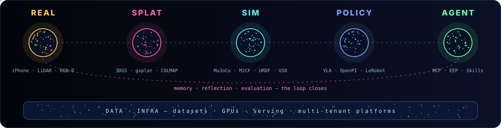

## From pixels to policy

I build the infrastructure around robot learning: capturing the real world, turning it into simulation, evaluating policies there, and giving coding agents a safe way to drive the whole loop.

## Embodied intelligence

| Project | What it does |
|---|---|
| [**opengeniemaster**](https://github.com/eust-w/opengeniemaster) | Open-source embodied agent harness. Embodied Execution Protocol over MCP, safety interlocks, versioned memory, and a semantic multi-robot simulator that models seven failure modes. |
| [**amd-bigym-3dgs-rocm**](https://github.com/eust-w/amd-bigym-3dgs-rocm) | 3D Gaussian Splatting kitchen shell for BiGym and MuJoCo, reproduced on AMD ROCm with verified W7900D artifacts. |
| [**amd-bigym-openpi-eval**](https://github.com/eust-w/amd-bigym-openpi-eval) | Reproducible OpenPI (JAX) evaluation on BiGym, MuJoCo and 3DGS, with full three-camera recording. |
| [**WorldSpec**](https://github.com/eust-w/WorldSpec) | Canonical world semantics, evidence and validation, compiled to multiple simulators. |
| [**robodata**](https://github.com/eust-w/robodata) | Robot dataset conversion, inspection, quality analysis and episode segmentation. |
| [**open-embodied-simops**](https://github.com/eust-w/open-embodied-simops) | Self-hosted workbench for simulation integrations, dataset tools and artifact provenance. |

## Real2Sim and 3D Gaussian Splatting

| Project | What it does |
|---|---|
| [**real2simcapture**](https://github.com/eust-w/real2simcapture) | iPhone ARKit / RGB-D capture to simulation assets, exported as MJCF, URDF and USD. |
| [**images23dgs**](https://github.com/eust-w/images23dgs) | Image and RGB-D to 3DGS in one web product. |
| [**gsstudio-public**](https://github.com/eust-w/gsstudio-public) | Gaussian Splatting studio with FastAPI, React and HY-World. |
| [**Real2Motrix**](https://github.com/eust-w/Real2Motrix) | Local capture and mesh processing into validated MJCF / URDF scene packages. |
| [**real2sim-platform**](https://github.com/eust-w/real2sim-platform) | Local-first 3D assets, material presets and reproducible Genesis FEM exports. |
| [**shanghai-city-digital-twin-plan**](https://github.com/eust-w/shanghai-city-digital-twin-plan) | OpenStreetMap to 3D city assets with provenance and explicit validation limits. |

## AI4AI: agents that build, test and evolve agents

| Project | What it does |
|---|---|
| [**agentic-embedded-lab**](https://github.com/eust-w/agentic-embedded-lab) | Agent-native embedded systems lab: pluggable simulation, evidence-driven validation, controlled evolution. |
| [**open-robotics-plugin**](https://github.com/eust-w/open-robotics-plugin) | Robotics skills for Claude Code, Codex, Gemini CLI and Cursor: MuJoCo, perception, planning, sim2real. |
| [**CSNative**](https://github.com/eust-w/CSNative) | Provider routing and custom models for Claude Science, in Go and Wails. |
| [**kakashi**](https://github.com/eust-w/kakashi) | Codex-powered capability fusion across GitHub repositories. |
| [**codex-dispatch**](https://github.com/eust-w/codex-dispatch) | Local-first task queues for Codex CLI with SQLite persistence. |
| [**actor-map**](https://github.com/eust-w/actor-map) | Turns a product conversation into an assertable map of roles and states. |
| [**superscience**](https://github.com/eust-w/superscience) | Local research workbench for papers, code, notebooks and traceable evidence. |
| [**cityagent-public**](https://github.com/eust-w/cityagent-public) | LoRA training and W8A8 quantization for evidence-backed report extraction. |

## Toolbox

## More tools and experiments

| Project | What to explore |
| :--- | :--- |
| **Camera geometry & recovery** | [camera-undistortion](https://github.com/eust-w/camera-undistortion) · [amdcompetition](https://github.com/eust-w/amdcompetition) |
| **Research & agents** | [esm2agent](https://github.com/eust-w/esm2agent) · [kakashi](https://github.com/eust-w/kakashi) · [ai_code_reviewer](https://github.com/eust-w/ai_code_reviewer) |
| **Developer infrastructure** | [esh](https://github.com/eust-w/esh) · [qcow2file](https://github.com/eust-w/qcow2file) · [keydesk](https://github.com/eust-w/keydesk) · [json_filter](https://github.com/eust-w/json_filter) |
| **Applications & learning** | [studyfit-atlas](https://github.com/eust-w/studyfit-atlas) · [EmboPlot](https://github.com/eust-w/EmboPlot) · [content-publisher](https://github.com/eust-w/content-publisher) · [qmulator](https://github.com/eust-w/qmulator) |
| **Earlier tools** | [openai-chat-switch](https://github.com/eust-w/openai-chat-switch) · [little_language_model](https://github.com/eust-w/little_language_model) · [obsidian-image-auto-upload](https://github.com/eust-w/obsidian-image-auto-upload) |

Each repository documents its current scope, validation status and licensing.

## Connect

Project questions and contributions are welcome in the relevant repository’s Issues and Pull Requests.

[Website](https://longtao.fun) · [Hugging Face](https://huggingface.co/eustance) · [X](https://x.com/eustancewu)

---

 Technology for good · Robotics · Agents · Research tooling

