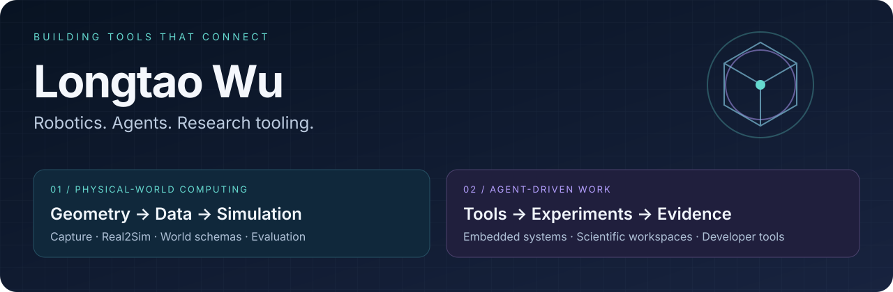
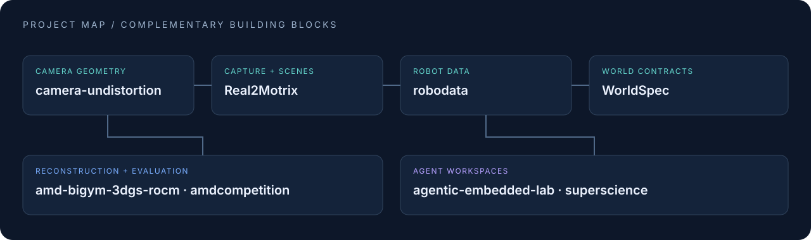

  
  <h1>Longtao Wu</h1>
  
<strong>我构建机器人数据、Real2Sim、仿真流程，以及 Agent 驱动的工程与科研工具。</strong>

  
<a href="https://longtao.fun">Website</a> · <a href="https://huggingface.co/eustance">Hugging Face</a> · <a href="https://x.com/eustancewu">X</a>

  
<a href="README.md">English</a> · <a href="README_CN.md">中文</a> · <a href="README_FR.md">Français</a> · <a href="README_RU.md">Русский</a> · <a href="README_AR.md">العربية</a> · <a href="README_JP.md">日本語</a> · <a href="README_PTBR.md">Português</a> · <a href="README_TR.md">Türkçe</a>

  
<a href="#projects">公开项目精选</a> · <a href="#toolchain">项目之间的关系</a> · <a href="#more">更多工具与探索</a>

我的工作连接真实世界输入与可检查的软件系统：相机几何、数据集、世界描述、运行时适配器和科研工作区。

## 公开项目精选

| 项目 | 可以从这里了解什么 |
| :--- | :--- |
| **[agentic-embedded-lab](https://github.com/eust-w/agentic-embedded-lab)** | 面向 Agent 的嵌入式实验、仿真适配与验证记录。 |
| **[amd-bigym-3dgs-rocm](https://github.com/eust-w/amd-bigym-3dgs-rocm)** | AMD ROCm 3DGS 重建与 BiGym 评测流程。 |
| **[WorldSpec](https://github.com/eust-w/WorldSpec)** | 世界描述 Schema、校验、来源追踪与仿真导出契约。 |
| **[robodata](https://github.com/eust-w/robodata)** | 机器人数据集转换、检查与质量分析，当前为 Alpha。 |
| **[Real2Motrix](https://github.com/eust-w/Real2Motrix)** | 本地采集与网格处理，导出 MJCF / URDF 场景包。 |
| **[superscience](https://github.com/eust-w/superscience)** | 集工具、Notebook 和来源记录于一体的本地科研 AI 工作台。 |

## 项目之间的关系

这是互补项目之间的概念流程。具体集成、运行条件与验收结果以各仓库说明为准。

我重视可复现的示例、清楚的接口，以及能够支持结果判断的证据。

## 更多工具与探索

| 项目 | 可以从这里了解什么 |
| :--- | :--- |
| **相机几何与失败恢复** | [camera-undistortion](https://github.com/eust-w/camera-undistortion) · [amdcompetition](https://github.com/eust-w/amdcompetition) |
| **科研与 Agent** | [esm2agent](https://github.com/eust-w/esm2agent) · [kakashi](https://github.com/eust-w/kakashi) · [ai_code_reviewer](https://github.com/eust-w/ai_code_reviewer) |
| **开发者基础设施** | [esh](https://github.com/eust-w/esh) · [qcow2file](https://github.com/eust-w/qcow2file) · [keydesk](https://github.com/eust-w/keydesk) · [json_filter](https://github.com/eust-w/json_filter) |
| **应用与教学探索** | [studyfit-atlas](https://github.com/eust-w/studyfit-atlas) · [EmboPlot](https://github.com/eust-w/EmboPlot) · [content-publisher](https://github.com/eust-w/content-publisher) · [qmulator](https://github.com/eust-w/qmulator) |
| **早期工具** | [openai-chat-switch](https://github.com/eust-w/openai-chat-switch) · [little_language_model](https://github.com/eust-w/little_language_model) · [obsidian-image-auto-upload](https://github.com/eust-w/obsidian-image-auto-upload) |

各仓库分别说明当前范围、验证状态与许可证。

## 联系与协作

欢迎在对应仓库的 Issues 和 Pull Requests 中交流问题或贡献改进。

[Website](https://longtao.fun) · [Hugging Face](https://huggingface.co/eustance) · [X](https://x.com/eustancewu)

---

 Technology for good · Robotics · Agents · Research tooling

